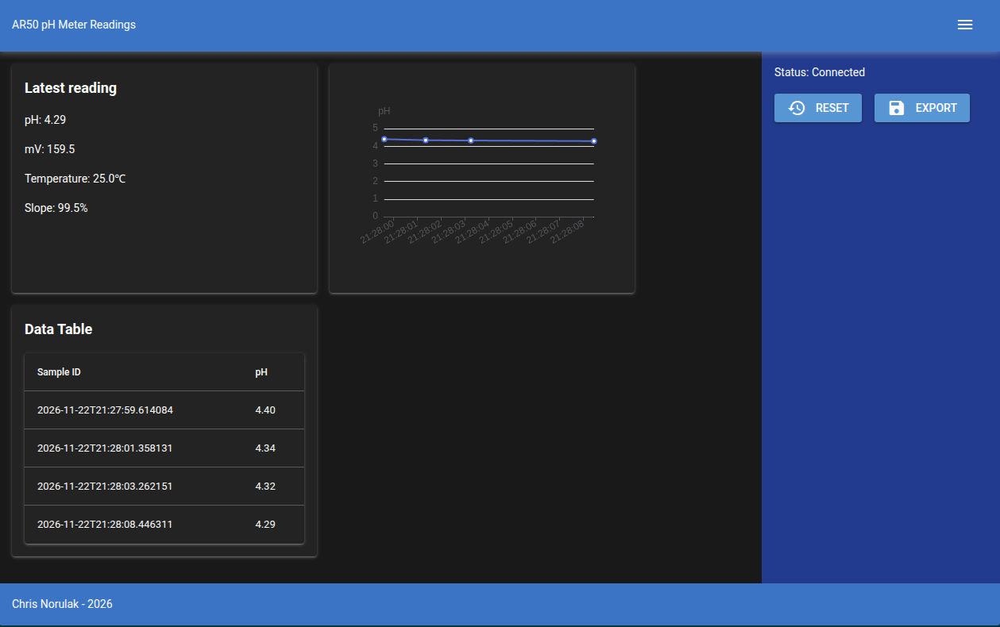

# AR 50 Data Recorder

This project uses pyvisa inside a docker container to view and save pH data from the Accumet AR50 using a RS232/USB serial connector. It uses nicegui to display the data as its being used.

## Usage

Install docker
Plug in the pH meter
Run `docker compose up --build --watch` from the project folder (`--build` can be omitted after first usage)
Open `http://localhost:8080`
Hit `Print` on the pH meter for it to send results